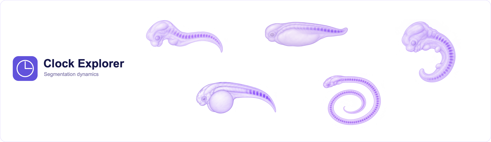

<p align="center">
  
</p>

<p align="center">
  <a href="https://segmentation-clock-explorer.pages.dev/"></a>
  <a href="https://github.com/qhuang20/clock-explorer/actions/workflows/ci.yml"></a>
  
  
  <a href=".agents/skills/"></a>
  
</p>

Clock Explorer brings together segmentation-clock experiments across species
and redraws kymographs from published data and time-lapse videos in a consistent
visual format. Explore mouse, zebrafish, medaka and human stem-cell models side
by side to compare oscillations, traveling waves and their arrest during somite
formation. The goal is to make shared patterns and species-specific differences
easier to see and use as a reference for modeling.

[Open the explorer](https://segmentation-clock-explorer.pages.dev/)

## Features

- Compare experimental kymographs across species, studies and time windows.
- Inspect reporters, temperature, coordinates, sampling methods and provenance.
- Select and export time ranges while preserving values and missing measurements.
- Play related time-lapse videos, inspect available sampling ROIs and browse papers.

Display values are normalized per sample; colors do not compare absolute
expression across papers.

## Run locally

Requires Node.js 22+ and Python 3.10+. The website needs no Python packages.

```sh
git clone https://github.com/qhuang20/clock-explorer.git
cd clock-explorer
npm ci
npm run build
npm start
```

Open the local URL printed in the terminal (normally <http://127.0.0.1:8765>).
If that port is busy, the app selects a free one. This address serves your own
computer. To use a fixed port, run `npm start -- --port 8766`.

The repository is currently private, so cloning requires access. Notes are stored
in your browser for each local address; keep the same port to return to them.

A fresh clone loads research assets from their source URLs. To download the core
assets for local use:

```sh
npm run data:fetch
npm run build
```

Videos and original source archives are optional. See [data and downloads](docs/data-provenance.md)
for download options, checksums and scientific limitations.

## Develop and contribute

```sh
npm run dev       # build and serve locally
npm run check     # validate metadata and code
npm test          # run regression tests
```

`npm run build` writes the public site to `dist/`. It skips assets marked
`local_only` in `catalog/assets.json` and links to the original source video.
`npm run dev` keeps those assets available for private inspection when installed
in the ignored `assets/` directory. It serves a separate build from
`.local/preview/` on loopback. Use `npm run dev -- --port 8780` to select a port.

Edit the interface in `web/`, records in `catalog/`, and analysis in `analysis/`.
`dist/` is generated. See the [contribution guide](.github/CONTRIBUTING.md),
[architecture](docs/architecture.md), [reproduction guide](docs/reproducing.md)
and [hosting guide](docs/hosting.md).

## License and citation

Original software and documentation use the [MIT license](LICENSE).
Papers, videos, data and derived research figures retain their own terms;
see [third-party notices](docs/THIRD_PARTY_NOTICES.md).

Cite the [Zenodo software record](https://doi.org/10.5281/zenodo.24571341)
using [CITATION.cff](CITATION.cff). Cite the original papers when using their
data or figures.
